<h1 align="center">Jhohan Jancco Chara</h1>

<h3 align="center">
  Reinforcement Learning Research Engineer | Electronic Engineer
</h3>

  <a href="https://jhohanjc.github.io">
    Academic Homepage
  </a>
  &nbsp;·&nbsp;
  <a href="https://www.credly.com/users/jhohan.jc">
    Credly
  </a>

<h2>Research Interests</h2>

<ul>
  <li>Markov Decision Processes</li>
  <li>Deep Reinforcement Learning</li> 
  <li>Model-Based Reinforcement Learning</li>
  <li>Model-Free Reinforcement Learning</li>
  <li>Inverse Reinforcement Learning</li>
  <li>Online Reinforcement Learning</li>
  <li>Offline Reinforcement Learning</li>
  <li>Applications of Reinforcement Learning</li>
  <li>Intelligent Control</li>
  <li>Machine Learning</li>
</ul>
<h2>Computational Tools</h2>

  

  <strong>Simulation Environments:</strong>
  Gymnasium · PyBullet · MuJoCo

<h3 align="center">GitHub Statistics</h3>

  

